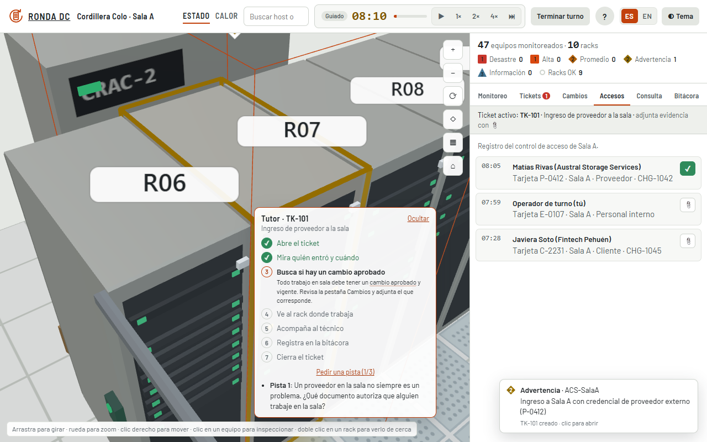
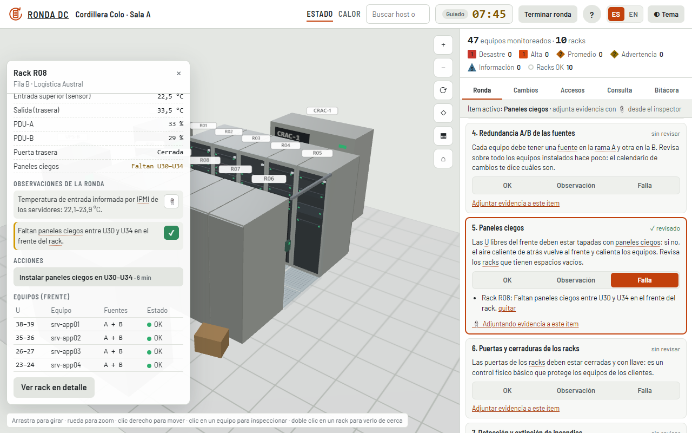
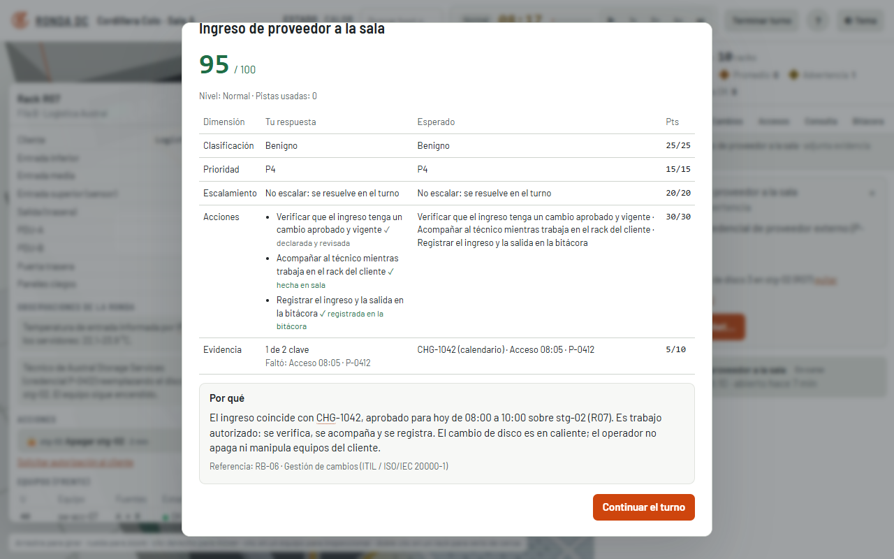
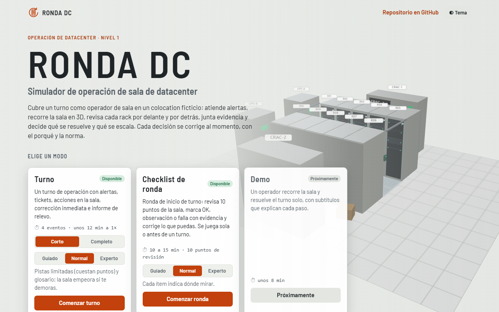

<p align="center">
  
</p>

<p align="center">
  <a href="https://nicsanchezr.github.io/ronda-dc/"></a>
</p>

<p align="center">
  <b>Simulador 3D de un turno de operación en una sala de datacenter.</b><br>
  Checklist de ronda, alertas, tickets, escalamiento y corrección inmediata. Un solo archivo HTML, sin servidor.
</p>

<p align="center">
  <a href="#qué-es">Qué es</a> ·
  <a href="#qué-se-aprende">Qué se aprende</a> ·
  <a href="#cómo-se-juega">Cómo se juega</a> ·
  <a href="#marco-de-referencia">Marco de referencia</a> ·
  <a href="#cómo-compilar">Cómo compilar</a> ·
  <a href="#in-english">In English</a>
</p>

---


## Qué es

**Ronda DC** pone al estudiante en el puesto de un **operador de sala N1** durante un turno (corto, de 08:00 a 10:30, o completo, hasta las 15:00) en *Cordillera Colo · Sala A*, un colocation ficticio en Santiago con 10 racks de tres clientes, dos CRAC, dos UPS, detección de fugas y control de acceso.

Las alertas de monitoreo abren tickets. El estudiante recorre la sala en 3D, revisa cada rack U por U, junta evidencia y decide: qué es un problema real, qué prioridad tiene, qué hacer y a quién escalar. Al cerrar cada ticket recibe la corrección al momento, con lo esperado, el porqué y la norma que lo respalda. Si se demora o toma una acción crítica, la sala empeora.

**Para quién:** estudiantes de técnico y de ingeniería en redes, infraestructura y soporte TI, y docentes que buscan una actividad práctica de operación de datacenter sin necesidad de una sala real. También sirve como repaso para quien empieza a trabajar en un NOC o en un colocation.

## Qué se aprende

- **Gestión de incidentes:** clasificar una alerta (verdadero positivo, falso positivo o benigno), asignar prioridad y SLA, y escalar a quien corresponde.
- **Condiciones ambientales:** leer temperaturas de entrada, reconocer recirculación de aire caliente y paneles ciegos faltantes, y actuar ante la falla de un CRAC.
- **Energía redundante:** entender las ramas A y B, detectar un equipo con las dos fuentes en la misma PDU y anticipar el disparo de un interruptor.
- **Seguridad física:** revisar el control de acceso, puertas abiertas y equipos manipulados, sin alterar la evidencia.
- **Gestión de cambios:** distinguir un trabajo autorizado de uno que no lo está, y no intervenir equipos de clientes sin su autorización.
- **Documentación:** adjuntar evidencia, escribir la bitácora y redactar el relevo para el turno siguiente.

## Cómo se juega

1. En la portada, elige **Turno**, su duración (**Corto**, 4 eventos y unos 12 min, o **Completo**, 8 eventos) y su nivel (**Guiado**, **Normal** o **Experto**): la cámara entra a la sala y aparece un briefing breve (las mismas instrucciones quedan en el botón **?** durante todo el turno). Luego comienza el turno: el reloj avanza (1 minuto del turno = 5 segundos a 1×) y puedes pausar, acelerar o adelantar (⏭) al siguiente evento; si adelantas con tickets abiertos, la sala sigue empeorando.
2. Las alertas de severidad Advertencia o superior **crean un ticket**. En la sala, los racks con alarma muestran un contorno y un ícono cuya forma indica la prioridad: cuadrado (1), rombo (2), triángulo (3).
3. **Inspecciona:** clic en racks, CRAC, UPS o el piso. **Doble clic en un rack** para verlo de cerca, por delante y por detrás: cada equipo con sus LED, sus fuentes y la PDU a la que va cada una.
4. **Adjunta evidencia** (📎) desde la sala, el monitoreo, el calendario de cambios y el registro de accesos.
5. **Actúa en la sala** desde el inspector: reubicar un sensor, instalar paneles ciegos, levantar una baldosa, contener una fuga, fotografiar, asegurar una puerta… Cada acción toma minutos de juego (el reloj corre a 8×), tiene una animación en 3D y cambia la sala de verdad. Los equipos de clientes requieren **solicitar autorización** antes de intervenirlos.
6. **Cierra el ticket:** clasificación, prioridad, acciones y escalamiento. Las acciones hechas en sala ya aparecen marcadas; **declarar algo que no hiciste cuenta como error**. Si corriges un problema antes de que salte la alerta, queda como **hallazgo proactivo** (+10).
7. Al final del turno: puntaje, MTTA, MTTR, disponibilidad, impactos e **informe de relevo** en Markdown, con el nivel jugado y las pistas usadas.

| Acciones en sala | Tutor del nivel Guiado |
|---|---|
|  |  |

**Glosario:** los términos técnicos (rack, U, CRAC, PDU, SLA, P1–P4…) aparecen subrayados en alertas, observaciones, runbooks y explicaciones; al pasar el mouse o tocarlos se ve una definición para principiantes con un ejemplo en la sala. Todos están en la pestaña **Consulta → Glosario**.


### Checklist de ronda

Antes del turno (o como actividad corta de clase), el estudiante recorre la sala y revisa 10 puntos: temperatura, CRAC, UPS, redundancia A/B, paneles ciegos, puertas, detección de incendios, orden y limpieza, control de acceso y piso técnico. Marca cada uno como **OK**, **observación** o **falla** y adjunta la evidencia desde el inspector. Hay cinco hallazgos plantados; corregir en la sala lo que está a su alcance suma puntos, y al terminar puede comenzar el turno con la sala tal como la dejó. En Guiado, cada ítem explica qué revisar y por qué.



| Vista de detalle del rack | Corrección de un ticket |
|---|---|
|  |  |

<p align="center">
  <br>
  <sub>La cámara entra al rack, lo rodea hasta la trasera y vuelve a la sala, sin cambiar de pantalla.</sub>
</p>

## Modos



Cada modo se puede enlazar directamente: [`#turno/normal/corto`](https://nicsanchezr.github.io/ronda-dc/#turno/normal/corto) (`#turno/<nivel>/<duración>`, con nivel `guiado`, `normal` o `experto` y duración `corto` o `completo`), [`#checklist/guiado`](https://nicsanchezr.github.io/ronda-dc/#checklist/guiado) (`#checklist/<nivel>`) y [`#demo`](https://nicsanchezr.github.io/ronda-dc/#demo).

| Modo | Estado | Descripción |
|---|---|---|
| **Turno** | Disponible | Corto (08:00–10:30, 4 eventos, unos 12 min) o completo (08:00–15:00, 8 eventos), con acciones en sala, corrección por ticket e informe final. Tres niveles: **Guiado** (tutor paso a paso, tutorial de la interfaz, pistas y sin presión de tiempo), **Normal** (pistas limitadas que cuestan puntos) y **Experto** (sin pistas, el reloj no se detiene al cerrar y hay eventos que coinciden). |
| **Checklist de ronda** | Disponible | Ronda de inicio de turno de 10 a 15 min: 10 ítems verificables en la sala (temperatura, CRAC, UPS, redundancia A/B, paneles ciegos, puertas, VESDA y extintores, limpieza, control de acceso, piso técnico) con cinco hallazgos plantados, puntaje propio e informe. Se juega sola o antes de un turno, en los tres niveles. |
| **Demo** | Próximamente | Reproducción automática con un operador que inspecciona, adjunta evidencia y cierra los tickets, con subtítulos. Pensado para ferias y clases. |

**Temas:** *Gris de sala* (por defecto, pensado para proyector) y *Alto rendimiento*, que sigue el criterio ISA-101 de pantallas de operación: todo en grises y color solo para lo anormal. Ambos en claro y oscuro (o según el sistema), con contraste WCAG AA verificado.

## Marco de referencia

Cada corrección explica el porqué y cita la referencia en que se apoya:

| Referencia | Dónde aparece |
|---|---|
| **ASHRAE TC 9.9** | Rango recomendado de temperatura de entrada (18–27 °C), puntos de medición y gestión del flujo de aire. |
| **ANSI/TIA-942** | Alimentación redundante A/B, detección de fugas bajo el piso técnico. |
| **ISO/IEC 27001:2022** | Controles físicos (A.7): accesos, puertas y equipos manipulados. |
| **ISO/IEC 20000-1** | Gestión de servicios: incidentes y cambios. |
| **ITIL 4** | Prácticas de gestión de incidentes y de cambios, priorización y escalamiento. |

También se citan Uptime Institute Tiers (redundancia), IEEE 1188 (baterías) y el EU Code of Conduct for Data Centres (eficiencia del flujo de aire).

## Stack y privacidad

- **Un solo archivo HTML** (`dist/index.html`, unos 900 KB): JavaScript, CSS, tipografías y escena 3D incluidos.
- **Sin servidor y sin peticiones externas:** no carga nada de Internet, no tiene analítica ni cookies. Funciona sin conexión.
- Lo único que se guarda es local, en el navegador (`localStorage`): el último puntaje, el nivel, la duración y el tema elegidos.
- [Three.js](https://threejs.org) 0.160 para la escena 3D y [esbuild](https://esbuild.github.io) para empaquetar.
- Empresa, personas, clientes, equipos y modelos son **ficticios**.

## Cómo compilar

Requiere Node.js 20 o superior (el CI usa Node 24).

```bash
npm install
npm run build        # genera dist/index.html
npm run contrast     # verifica el contraste WCAG AA de los temas
npm test             # compila y corre las pruebas de Playwright (Edge en Windows, Chromium en CI)
```

Abre `dist/index.html` directamente en el navegador. En cada push a `main`, GitHub Actions corre las pruebas (partida perfecta, impactos, nivel Guiado, hallazgo proactivo, acción declarada sin hacer, turno corto y ⏭, checklist de ronda, glosario, temas y transiciones) y, solo si pasan, publica `dist/` en GitHub Pages.

Estructura y convenciones del código: [`.claude/CLAUDE.md`](.claude/CLAUDE.md). Próximas mejoras: [`docs/ROADMAP.md`](docs/ROADMAP.md). Historial: [`CHANGELOG.md`](CHANGELOG.md).

## Créditos y licencia

Creado por **Nicolás Sánchez Rodríguez**. Inspirado en el enfoque de [Blue-Jr](https://heindall92.github.io/Blue-Jr/): turno con alertas, tickets, decisiones corregidas al momento e informe final.

- Código: licencia [MIT](LICENSE).
- Tipografías Barlow, JetBrains Mono y Atkinson Hyperlegible: SIL Open Font License 1.1 ([detalle](assets/fonts/LICENCIAS.md)).
- Three.js: licencia MIT.

---

## In English

<p align="center">
  <a href="#what-it-is">What it is</a> ·
  <a href="#what-you-learn">What you learn</a> ·
  <a href="#how-to-play">How to play</a> ·
  <a href="#modes-1">Modes</a> ·
  <a href="#reference-framework">Reference framework</a> ·
  <a href="#how-to-build">How to build</a>
</p>

### What it is

**Ronda DC** puts the student in the seat of a **level-1 data center floor operator** during a shift (short, from 08:00 to 10:30, or full, until 15:00) at *Cordillera Colo · Data Hall A*, a fictional colocation facility in Santiago, Chile, with 10 racks from three customers, two CRACs, two UPSs, leak detection and access control.

Monitoring alerts open tickets. The student walks the data hall in 3D, checks every rack unit by unit, gathers evidence and decides: what is a real problem, what priority it has, what to do and who to escalate to. Each ticket is graded the moment it is closed, with the expected answer, the reasoning and the standard behind it. Take too long or do something critical and the data hall gets worse.

The whole interface, the scenario, the glossary and the exported report are available in **Spanish and English**. The language follows the browser on the first visit and can be switched at any time from the home page or the header (ES | EN) without losing the shift in progress: open tickets, the shift log and the grading switch language on the spot.

**Who it is for:** students of networking, infrastructure and IT support programs, and instructors looking for a hands-on data center operations activity without a real data hall. It also works as a refresher for anyone starting out in a NOC or a colocation facility.

### What you learn

- **Incident management:** classify an alert (true positive, false positive or benign), set priority and SLA, and escalate to the right team.
- **Environmental conditions:** read inlet temperatures, spot hot air recirculation and missing blanking panels, and respond to a CRAC failure.
- **Redundant power:** understand A and B feeds, detect a device with both PSUs on the same PDU and anticipate a breaker trip.
- **Physical security:** review access control, open doors and tampered equipment without altering the evidence.
- **Change management:** tell authorized work from unauthorized work, and never touch customer equipment without their authorization.
- **Documentation:** attach evidence, keep the shift log and write the handover for the next shift.

### How to play

1. On the home page, choose **Shift**, its length (**Short**, 4 events and about 12 minutes, or **Full**, 8 events) and its level (**Guided**, **Normal** or **Expert**): the camera flies into the data hall and a short briefing appears (the same instructions stay available behind the **?** button for the whole shift). Then the shift starts: the clock runs (1 shift minute = 5 seconds at 1×) and you can pause, speed up or skip (⏭) to the next event; if you skip with open tickets, the data hall keeps getting worse.
2. Alerts of Warning severity or higher **open a ticket**. In the data hall, racks with an alarm get an outline and an icon whose shape shows the priority: square (1), diamond (2), triangle (3).
3. **Inspect:** click racks, CRACs, UPSs or the floor. **Double-click a rack** to see it up close, front and rear: every device with its LEDs, its PSUs and the PDU each one is plugged into.
4. **Attach evidence** (📎) from the floor, monitoring, the change calendar and the access log.
5. **Act on the floor** from the inspector: reseat a sensor, install blanking panels, lift a floor tile, contain a leak, take photos, secure a door… Each action takes game minutes (the clock runs at 8×), has a 3D animation and really changes the data hall. Customer equipment requires **requesting authorization** first, just like a remote hands job.
6. **Close the ticket:** classification, priority, actions and escalation. Actions done on the floor are already checked; **declaring something you did not do counts as an error**. If you fix a problem before its alert fires, it becomes a **proactive finding** (+10).
7. At the end of the shift: score, MTTA, MTTR, availability, impacts and a **handover report** in Markdown (in the active language), with the level played and the hints used.

**Glossary:** technical terms (rack, U, CRAC, PDU, SLA, P1–P4…) are underlined in alerts, observations, runbooks and explanations; hovering over or tapping one shows a beginner-friendly definition with an example from the data hall. They are all in the **Reference → Glossary** tab, in both languages.

#### Rounds checklist

Before the shift (or as a short classroom activity), the student walks the data hall and checks 10 items: temperature, CRACs, UPSs, A/B redundancy, blanking panels, doors, fire detection, housekeeping, access control and the raised floor. Each one is marked **OK**, **observation** or **fault** with evidence attached from the inspector. There are five planted findings; fixing on the floor whatever is within reach earns points, and at the end the student can start the shift with the data hall exactly as they left it. In Guided mode, each item explains what to check and why.

### Modes

Every mode can be linked directly: [`#turno/normal/corto`](https://nicsanchezr.github.io/ronda-dc/#turno/normal/corto) (`#turno/<level>/<length>`, with level `guiado`, `normal` or `experto` and length `corto` or `completo`), [`#checklist/guiado`](https://nicsanchezr.github.io/ronda-dc/#checklist/guiado) (`#checklist/<level>`) and [`#demo`](https://nicsanchezr.github.io/ronda-dc/#demo).

| Mode | Description |
|---|---|
| **Shift** | Short (08:00–10:30, 4 events, about 12 min) or full (08:00–15:00, 8 events), with hands-on actions, per-ticket grading and a final report. Three levels: **Guided** (step-by-step tutor, interface tutorial, hints and no time pressure), **Normal** (limited hints that cost points) and **Expert** (no hints, the clock keeps running while you close tickets and some events overlap). |
| **Rounds checklist** | Start-of-shift rounds of 10 to 15 minutes: 10 checkpoints (temperature, CRACs, UPSs, A/B redundancy, blanking panels, doors, VESDA and extinguishers, housekeeping, access control, raised floor) with five planted findings, their own score and a report. Play it on its own or before a shift, at any of the three levels. |
| **Demo** | Automatic playback with an operator who inspects, attaches evidence and closes the tickets, with captions. Built for fairs and classes. |

**Themes:** *Floor grey* (default, designed for projectors) and *High performance*, which follows the ISA-101 approach to operator displays: everything in greys, with color reserved for abnormal conditions. Both come in light and dark (or follow the system), with WCAG AA contrast verified.

### Reference framework

Every grading explains the reasoning and cites the reference behind it:

| Reference | Where it appears |
|---|---|
| **ASHRAE TC 9.9** | Recommended inlet temperature range (18–27 °C), measurement points and airflow management. |
| **ANSI/TIA-942** | Redundant A/B power, leak detection under the raised floor. |
| **ISO/IEC 27001:2022** | Physical controls (A.7): access, doors and tampered equipment. |
| **ISO/IEC 20000-1** | Service management: incidents and changes. |
| **ITIL 4** | Incident and change management practices, prioritization and escalation. |

Uptime Institute Tiers (redundancy), IEEE 1188 (batteries) and the EU Code of Conduct for Data Centres (airflow efficiency) are cited as well.

### Stack and privacy

- **A single HTML file** (`dist/index.html`, about 1 MB): JavaScript, CSS, fonts and the 3D scene included.
- **No server and no external requests:** nothing is loaded from the Internet, no analytics, no cookies. It works offline.
- The only things stored are local, in the browser (`localStorage`): the last score and the chosen level, length, language and theme.
- [Three.js](https://threejs.org) 0.160 for the 3D scene and [esbuild](https://esbuild.github.io) for bundling.
- Company, people, customers, equipment and models are **fictitious**.

### How to build

Requires Node.js 20 or later (CI uses Node 24).

```bash
npm install
npm run build        # generates dist/index.html
npm run contrast     # checks WCAG AA contrast for the themes
npm test             # builds and runs the Playwright tests (Edge on Windows, Chromium in CI)
```

Open `dist/index.html` directly in the browser. On every push to `main`, GitHub Actions runs the tests (perfect game in Spanish and English, impacts, Guided level, proactive finding, action declared but not done, short shift and ⏭, rounds checklist, glossary, dictionaries with no missing keys, live language switch, themes and transitions) and, only if they pass, publishes `dist/` to GitHub Pages.

**Translating:** interface texts live in `src/i18n/<lang>.js`, scenario texts in `src/i18n/escenario.<lang>.js` and the glossary in `src/i18n/glosario.<lang>.js`. A test fails if any key, list item or `{placeholder}` is missing in one of the languages.

Code structure and conventions: [`.claude/CLAUDE.md`](.claude/CLAUDE.md) (in Spanish). Next steps: [`docs/ROADMAP.md`](docs/ROADMAP.md). History: [`CHANGELOG.md`](CHANGELOG.md).

### Credits and license

Created by **Nicolás Sánchez Rodríguez**. Inspired by the approach of [Blue-Jr](https://heindall92.github.io/Blue-Jr/): a shift with alerts, tickets, decisions graded on the spot and a final report.

- Code: [MIT](LICENSE) license.
- Barlow, JetBrains Mono and Atkinson Hyperlegible fonts: SIL Open Font License 1.1 ([details](assets/fonts/LICENCIAS.md)).
- Three.js: MIT license.
