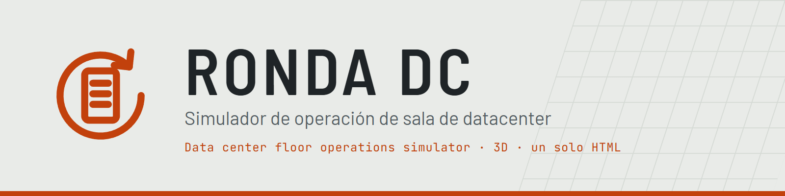
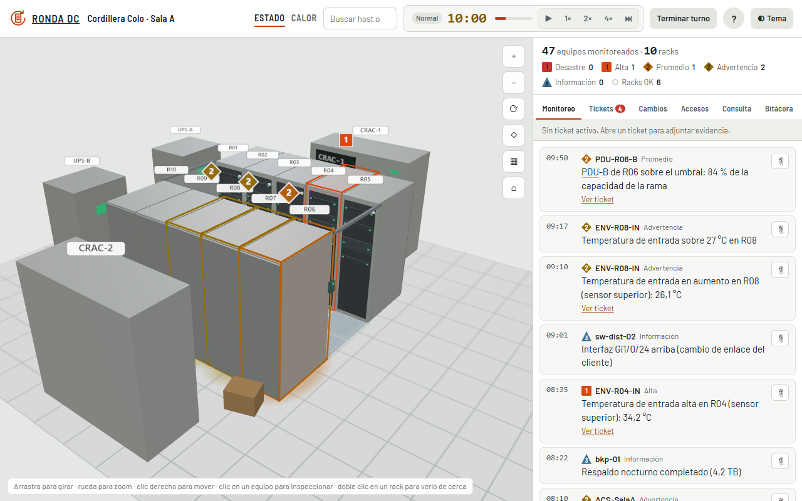
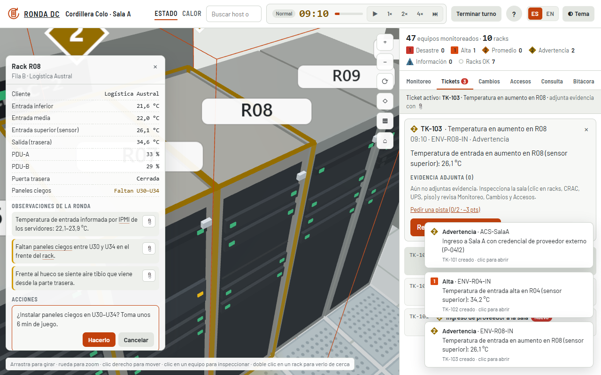
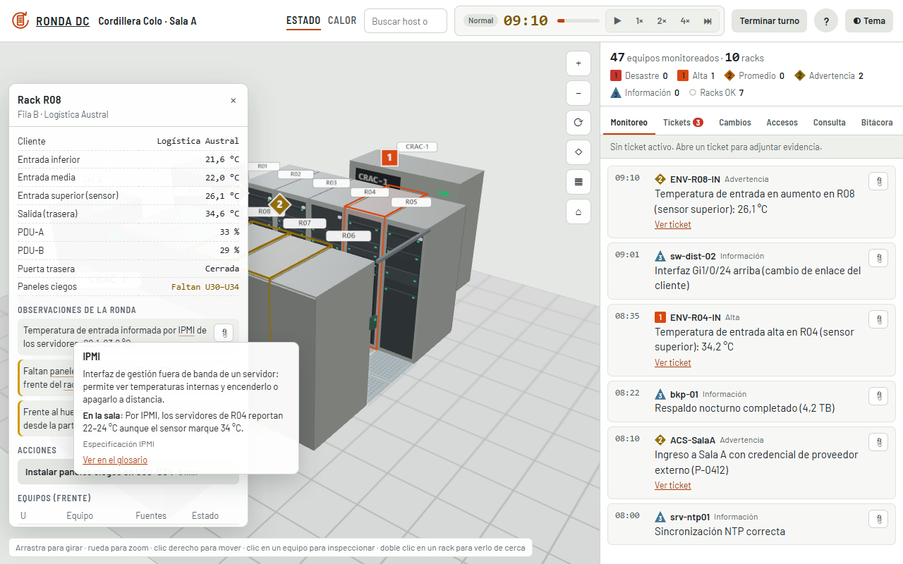
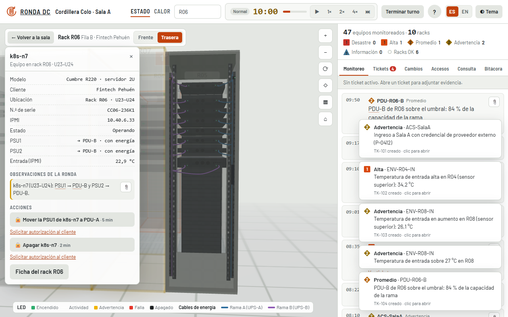
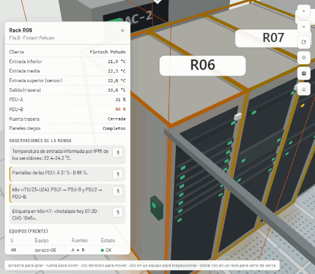

<p align="center">
  
</p>

<p align="center">
  <a href="https://nicsanchezr.github.io/ronda-dc/"></a>
</p>

<p align="center">
  <b>Simulador 3D de un turno de operación en una sala de datacenter.</b><br>
  Rondas, alertas, tickets, escalamiento y corrección inmediata. Un solo archivo HTML, sin servidor.
</p>

<p align="center">
  <a href="#qué-es">Qué es</a> ·
  <a href="#qué-se-aprende">Qué se aprende</a> ·
  <a href="#cómo-se-juega">Cómo se juega</a> ·
  <a href="#marco-de-referencia">Marco de referencia</a> ·
  <a href="#cómo-compilar">Cómo compilar</a> ·
  <a href="#in-english">In English</a>
</p>

---



## Qué es

**Ronda DC** pone al estudiante en el puesto de un **operador de sala N1** durante un turno de 08:00 a 15:00 en *Cordillera Colo · Sala A*, un colocation ficticio en Santiago con 10 racks de tres clientes, dos CRAC, dos UPS, detección de fugas y control de acceso.

Las alertas de monitoreo abren tickets. El estudiante recorre la sala en 3D, revisa cada rack U por U, junta evidencia y decide: qué es un problema real, qué prioridad tiene, qué hacer y a quién escalar. Al cerrar cada ticket recibe la corrección al momento, con lo esperado, el porqué y la norma que lo respalda. Si se demora o toma una acción crítica, la sala empeora.

**Para quién:** estudiantes de técnico y de ingeniería en redes, infraestructura y soporte TI, y docentes que buscan una actividad práctica de operación de datacenter sin necesidad de una sala real. También sirve como repaso para quien empieza a trabajar en un NOC o en un colocation.

## Qué se aprende

- **Gestión de incidentes:** clasificar una alerta (verdadero positivo, falso positivo o benigno), asignar prioridad y SLA, y escalar a quien corresponde.
- **Condiciones ambientales:** leer temperaturas de entrada, reconocer recirculación de aire caliente y paneles ciegos faltantes, y actuar ante la falla de un CRAC.
- **Energía redundante:** entender las ramas A y B, detectar un equipo con las dos fuentes en la misma PDU y anticipar el disparo de un interruptor.
- **Seguridad física:** revisar el control de acceso, puertas abiertas y equipos manipulados, sin alterar la evidencia.
- **Gestión de cambios:** distinguir un trabajo autorizado de uno que no lo está, y no intervenir equipos de clientes sin su autorización.
- **Documentación:** adjuntar evidencia, escribir la bitácora y redactar el relevo para el turno siguiente.

## Cómo se juega

1. En la portada, elige **Turno** y su nivel (**Guiado**, **Normal** o **Experto**): la cámara entra a la sala y aparece un briefing breve (las mismas instrucciones quedan en el botón **?** durante todo el turno). Luego comienza el turno: el reloj avanza (1 minuto del turno = 5 segundos a 1×) y puedes pausar, acelerar o adelantar al siguiente evento.
2. Las alertas de severidad Advertencia o superior **crean un ticket**. En la sala, los racks con alarma muestran un contorno y un ícono cuya forma indica la prioridad: cuadrado (1), rombo (2), triángulo (3).
3. **Inspecciona:** clic en racks, CRAC, UPS o el piso. **Doble clic en un rack** para verlo de cerca, por delante y por detrás: cada equipo con sus LED, sus fuentes y la PDU a la que va cada una.
4. **Adjunta evidencia** (📎) desde la sala, el monitoreo, el calendario de cambios y el registro de accesos.
5. **Actúa en la sala** desde el inspector: reubicar un sensor, instalar paneles ciegos, levantar una baldosa, contener una fuga, fotografiar, asegurar una puerta… Cada acción toma minutos de juego (el reloj corre a 8×), tiene una animación en 3D y cambia la sala de verdad. Los equipos de clientes requieren **solicitar autorización** antes de intervenirlos.
6. **Cierra el ticket:** clasificación, prioridad, acciones y escalamiento. Las acciones hechas en sala ya aparecen marcadas; **declarar algo que no hiciste cuenta como error**. Si corriges un problema antes de que salte la alerta, queda como **hallazgo proactivo** (+10).
7. Al final del turno: puntaje, MTTA, MTTR, disponibilidad, impactos e **informe de relevo** en Markdown, con el nivel jugado y las pistas usadas.

| Acciones en sala | Tutor del nivel Guiado |
|---|---|
|  |  |

**Glosario:** los términos técnicos (rack, U, CRAC, PDU, SLA, P1–P4…) aparecen subrayados en alertas, observaciones, runbooks y explicaciones; al pasar el mouse o tocarlos se ve una definición para principiantes con un ejemplo en la sala. Todos están en la pestaña **Consulta → Glosario**.



| Vista de detalle del rack | Corrección de un ticket |
|---|---|
|  |  |

<p align="center">
  <br>
  <sub>La cámara entra al rack, lo rodea hasta la trasera y vuelve a la sala, sin cambiar de pantalla.</sub>
</p>

## Modos


Cada modo se puede enlazar directamente: [`#turno`](https://nicsanchezr.github.io/ronda-dc/#turno) (o [`#turno/guiado`](https://nicsanchezr.github.io/ronda-dc/#turno/guiado) y [`#turno/experto`](https://nicsanchezr.github.io/ronda-dc/#turno/experto)), [`#checklist`](https://nicsanchezr.github.io/ronda-dc/#checklist) y [`#demo`](https://nicsanchezr.github.io/ronda-dc/#demo).

| Modo | Estado | Descripción |
|---|---|---|
| **Turno** | Disponible | El turno completo de 08:00 a 15:00 con ocho eventos, acciones en sala, corrección por ticket e informe final. Tres niveles: **Guiado** (tutor paso a paso, tutorial de la interfaz, pistas y sin presión de tiempo), **Normal** (pistas limitadas que cuestan puntos) y **Experto** (sin pistas, el reloj no se detiene al cerrar y hay eventos que coinciden). |
| **Checklist de ronda** | Próximamente | Ronda de inicio de turno con ítems verificables en la sala (temperatura, CRAC, UPS, puertas, paneles ciegos, piso técnico, VESDA, control de acceso), con hallazgos plantados. |
| **Demo** | Próximamente | Reproducción automática con un operador que inspecciona, adjunta evidencia y cierra los tickets, con subtítulos. Pensado para ferias y clases. |

**Temas:** *Gris de sala* (por defecto, pensado para proyector) y *Alto rendimiento*, que sigue el criterio ISA-101 de pantallas de operación: todo en grises y color solo para lo anormal. Ambos en claro y oscuro (o según el sistema), con contraste WCAG AA verificado.

## Marco de referencia

Cada corrección explica el porqué y cita la referencia en que se apoya:

| Referencia | Dónde aparece |
|---|---|
| **ASHRAE TC 9.9** | Rango recomendado de temperatura de entrada (18–27 °C), puntos de medición y gestión del flujo de aire. |
| **ANSI/TIA-942** | Alimentación redundante A/B, detección de fugas bajo el piso técnico. |
| **ISO/IEC 27001:2022** | Controles físicos (A.7): accesos, puertas y equipos manipulados. |
| **ISO/IEC 20000-1** | Gestión de servicios: incidentes y cambios. |
| **ITIL 4** | Prácticas de gestión de incidentes y de cambios, priorización y escalamiento. |

También se citan Uptime Institute Tiers (redundancia), IEEE 1188 (baterías) y el EU Code of Conduct for Data Centres (eficiencia del flujo de aire).

## Stack y privacidad

- **Un solo archivo HTML** (`dist/index.html`, unos 900 KB): JavaScript, CSS, tipografías y escena 3D incluidos.
- **Sin servidor y sin peticiones externas:** no carga nada de Internet, no tiene analítica ni cookies. Funciona sin conexión.
- Lo único que se guarda es local, en el navegador (`localStorage`): el último puntaje, el nivel y el tema elegidos.
- [Three.js](https://threejs.org) 0.160 para la escena 3D y [esbuild](https://esbuild.github.io) para empaquetar.
- Empresa, personas, clientes, equipos y modelos son **ficticios**.

## Cómo compilar

Requiere Node.js 20 o superior (el CI usa Node 24).

```bash
npm install
npm run build        # genera dist/index.html
npm run contrast     # verifica el contraste WCAG AA de los temas
npm test             # compila y corre las pruebas de Playwright (Edge en Windows, Chromium en CI)
```

Abre `dist/index.html` directamente en el navegador. En cada push a `main`, GitHub Actions corre las pruebas (partida perfecta, impactos, nivel Guiado, hallazgo proactivo, acción declarada sin hacer, glosario, temas y transiciones) y, solo si pasan, publica `dist/` en GitHub Pages.

Estructura y convenciones del código: [`.claude/CLAUDE.md`](.claude/CLAUDE.md). Próximas mejoras: [`docs/ROADMAP.md`](docs/ROADMAP.md). Historial: [`CHANGELOG.md`](CHANGELOG.md).

## Créditos y licencia

Creado por **Nicolás Sánchez Rodríguez**. Inspirado en el enfoque de [Blue-Jr](https://heindall92.github.io/Blue-Jr/): turno con alertas, tickets, decisiones corregidas al momento e informe final.

- Código: licencia [MIT](LICENSE).
- Tipografías Barlow, JetBrains Mono y Atkinson Hyperlegible: SIL Open Font License 1.1 ([detalle](assets/fonts/LICENCIAS.md)).
- Three.js: licencia MIT.

---

## In English

**Ronda DC** is a 3D, browser-based simulator of a shift as a level-1 operator on a data center floor. Monitoring alerts open tickets; you walk the room, inspect racks unit by unit (front and rear, with LEDs, power supplies and A/B PDUs), attach evidence, then classify, prioritise, act and escalate. Each ticket is graded on the spot with the expected answer, the reasoning and the standard behind it (ASHRAE TC 9.9, TIA-942, ISO/IEC 27001, ISO/IEC 20000, ITIL). The shift ends with a score, MTTA/MTTR, availability and a Markdown handover report.

- **Play it:** <https://nicsanchezr.github.io/ronda-dc/>
- **Modes:** Shift (available; Guided, Normal and Expert levels), Rounds checklist and Demo (coming soon).
- **Hands-on actions:** fix things in the room (reseat a sensor, install blanking panels, contain a leak, take photos…); customer equipment requires their authorisation. Declaring an action you did not perform counts as an error.
- **Glossary:** technical terms are underlined with beginner-friendly definitions, also on touch screens.
- **Themes:** *Floor grey* (default) and *High performance* (ISA-101 style), each in light and dark.
- **Privacy:** a single HTML file, no server, no external requests, no tracking. All companies, people and equipment are fictitious.
- **Build:** `npm install && npm run build` → `dist/index.html`.
- The interface is currently in Spanish; texts are centralised for an English version.

Code under the MIT license. Created by Nicolás Sánchez Rodríguez.
